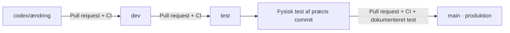

# Udvikling, enhedstest og produktion

Status: første opsætning af `dev`, `test` og `main` er godkendt 2026-10-25.
De tre branches starter på samme gennemgåede migrationsgrundlag med CI. Dette
er alene bootstrap, ikke en godkendt produktionsrelease eller en fysisk test.
GitHub-beskyttelsesregler skal aktiveres og verificeres separat før normal drift.



Samme model bruges i begge repos. Core forbliver privat i alle tre branches;
offentlige plugins og deres CI får ingen adgang til core-kilden eller dens artifacts.
Branches bruges til miljøerne; der oprettes ikke tre kopier af hvert repository.

1. Lav en opgave på `codex/...` fra `dev`; åbn PR til `dev` og kør CI.
2. Åbn PR fra `dev` til `test`. Andre kilder til `test` afvises af Promotion gate.
3. Frys kandidaten. Byg fra den konkrete `test`-commit og test på enheden.
   Notér SHA, enhed, core-/pluginversioner, relevante offline-/reconnect-/restarttests
   og resultat. Upload til enheden kræver stadig ejerens konkrete godkendelse.
4. Åbn PR fra `test` til `main`. Angiv felterne nedenfor med ægte testresultater.
   Ny commit på `test` kræver ny test. CI kontrollerer også, at PR-merge-resultatets
   Git-træ er identisk med den testede commits træ; ingen ekstra ændringer slipper med.
5. Merge med **merge commit**, bevar de langlivede branches, og opret efter accept
   et versionsmærke/release. Bevar den tidligere fungerende pakke til rollback.
   En produktionsudrulning er en separat godkendt handling, aldrig automatisk push/deploy.

```text
Hardware-tested-commit: <fuld 40-tegns SHA fra test>
Hardware-test-device: <enhed og hardware-revision>
Hardware-test-result: <resultat og reference til testnotat>
```

Felterne er menneskets attestering; CI kan ikke bevise, at hardwaretesten blev udført.
Lua-pluginets fysiske test er blokeret, indtil den private loader er implementeret.
Marker aldrig et migrationsudkast eller en simulatortest som fysisk bestået.

## GitHub-indstillinger før normal drift

- Standardbranch: `main`. Aktiver PR-krav for `dev`, `test` og `main`.
- På alle tre branches: kræv `Promotion gate` samt repoets samlede CI-check
  (`Firmware checks` for core, `Plugin checks` for plugins), opdateret branch,
  løste reviewkommentarer, ingen force-push eller sletning og ingen admin-bypass.
- Slå automatisk sletning af `dev`/`test` efter merge fra. Brug merge commits mellem
  langlivede branches; squash/rebase er ikke promotionsmetoden. Kræv ikke lineær historik.
- Kræv én uafhængig reviewer, når en anden betroet vedligeholder er tilknyttet.
  Ejeren kan ikke godkende sin egen PR; indtil da er fysisk ejeraccept og grøn CI
  minimumskravet, og reviewbegrænsningen skal dokumenteres.
- Kræv GitHub Actions som forventet kilde til statuschecks. Ingen hemmeligheder i
  fork-PR-jobs, ingen `pull_request_target` med udførelse af ukendt kode, og kun læseadgang.
- Branchbeskyttelse i private repos kræver en understøttet GitHub-plan. Verificér
  kontoplanen; uden serverregler er workflows alene ikke en blokering af direkte push.
- Første opsætning: seed de tre branches med gennemgået migrationsgrundlag,
  lad CI registrere checknavnene, aktiver/verificér reglerne og prøv en afvist
  `dev` → `main` PR. Ingen produktionsrelease før regler og enhedstest virker.

Fejlrettelser, også hastesager, følger `dev` → `test` → `main`. Under testfrys
venter næste ændring på `dev`; ændres `test`, gentages testen. Ved rollback anvendes
sidste godkendte artifact efter ejeraccept; en kildekoderevert følger samme PR-rute.

Kilder: [GitHub branch protection](https://docs.github.com/en/repositories/configuring-branches-and-merges-in-your-repository/managing-protected-branches/about-protected-branches)
og [rulesets](https://docs.github.com/en/repositories/configuring-branches-and-merges-in-your-repository/managing-rulesets/available-rules-for-rulesets).
